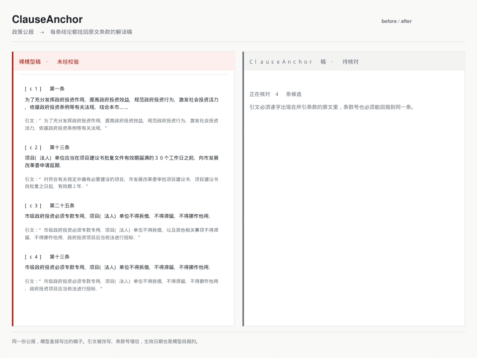
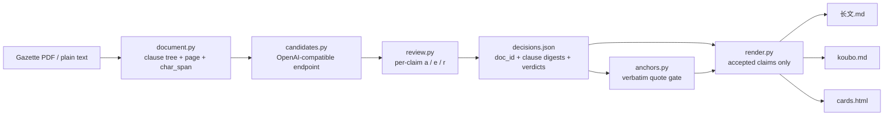

**English** | [简体中文](./README.md)

<p align="center">
  
</p>

<h1 align="center">ClauseAnchor</h1>

<p align="center">
  <b>Split a Chinese policy gazette into 第X条 clauses, and pin every conclusion to the clause, the effective date and a verbatim quote.</b><br>
  The model only proposes. You accept, rewrite or reject each claim, then export a WeChat longform, a 口播稿 voiceover script and a screenshot-ready card page.
</p>

<p align="center">
  <a href="./VERSION"></a>
  <a href="https://github.com/SuperMarioYL/clauseanchor/actions/workflows/ci.yml"></a>
  
  
  
  <a href="./LICENSE"></a>
</p>

> **In one sentence:** it does not make the writing better. It makes the quote behind every conclusion findable, word for word, in the clause it cites, and it requires every clause number named in the conclusion to be one of that claim's verified clauses.

---

## Why this exists

General-purpose models are already fluent at policy commentary. The failure is in low-entropy identifiers: clause numbers, effective dates, scope. A model treats `第X条` as ordinary text to smooth over, fills in a plausible-looking date, and blends a passage from a neighbouring clause into the quote. Better prose makes these errors harder to spot.

"Please cite your sources" only gets you to the document. The author still has to find 第几条 by hand. So the time goes into reconciliation, not writing: copying each conclusion back into the original to check the clause number and the date. That is a cost adoption created, not a prompt-quality problem.

ClauseAnchor makes that layer a tool of its own:

- Parsing keeps `第X条` / `第X款`, the page and the character span, so a clause is a citation unit rather than a chunk.
- Every conclusion carries a quote that must be an **exact substring** of the clause it asserts, after whitespace removal and full-width/half-width normalization.
- Every `第X条` / `第X条Y款` named in the conclusion must also be one of the claim's verified clauses, present in the document.
- A quote is only checked against the clauses the claim itself named. It is never silently re-pointed at a clause that happens to contain it.
- `decisions.json` stores the source `doc_id` and a text digest per clause snapshot; render and replay re-parse the source and compare.

If any check fails, the export fails and names the clause.

## Ten-minute start

Python 3.11+ and [uv](https://docs.astral.sh/uv/). `git clone` and the first `uv sync` need network; after installation, `demo`, `parse` and `render` run fully offline (no API key, no network), and only `draft` against a live model calls the endpoint:

```bash
git clone https://github.com/SuperMarioYL/clauseanchor.git
cd clauseanchor
uv sync
uv run clauseanchor demo
```

`demo` runs parse → candidates → review → export on the bundled sample and writes:

```text
out/decisions.json
out/长文.md
out/koubo.md
out/cards.html
out/demo-raw-model-draft.md
```

`demo-raw-model-draft.md` is the unverified model draft: it deliberately contains one rewritten quote and one quote filed under the wrong clause number. Neither reaches the other three files.

## Raw draft vs anchored draft

<p align="center">
  
</p>

Both columns of this GIF come from the same `clauseanchor demo` run, not from a drawing tool:

- The left column is `demo-raw-model-draft.md`: of four candidates, `c3` has "以及其他相关事项" inserted into its quote and `c4` files clause 第二十五条's text under 第十三条. The panel reproduces the draft's clause labels, model conclusions and quotes; the model's self-reported effective date `2027-01-01` also appears in the `demo` terminal output and `docs/demo-results.json`, but never in the exported pack.
- The right column is `长文.md`: only the two verified claims survive, each with its clause number, page, effective date and verbatim quote. The date comes from the parsed document, `2026-08-01`, not from the model.
- The middle frame is built from `decisions.json`: `c3` and `c4` are marked as blocked, with the clause each one failed on.

The comparison uses a real public policy PDF checked into the repository: [上海市市级政府投资管理办法](https://www.shanghai.gov.cn/nw12344/20260731/a637d94307e44a6789df18fa31f34c4b.html) (沪府规〔2026〕5号, effective 2026-08-01, 8 pages, 37 articles). Regenerate it with (`ffmpeg` must be on `PATH`):

```bash
uv run python assets/demo/make_clause_diff.py
```

The candidates in the demo come from a fixed offline stand-in model, and the review rule is fixed too: accept when the quote verifies, reject otherwise. `demo` never calls a model endpoint, which is why the counts repeat exactly. In real use the candidates come from DeepSeek / Qwen through an OpenAI-compatible endpoint, and you make every decision. The commands and output of each recorded run live in [docs/demo-results.json](./docs/demo-results.json).

## Real usage

```bash
# 1. Parse: inspect the clause tree, pages and effective date
uv run clauseanchor parse examples/real/sh_gov_investment_management.pdf

# 2. Draft candidates and review them one by one (needs an OpenAI-compatible endpoint)
export DEEPSEEK_API_KEY=sk-...
uv run clauseanchor draft examples/real/sh_gov_investment_management.pdf --model deepseek

# 3. Export: one failed quote rejects the whole pack
uv run clauseanchor render decisions.json -o out
```

Step 2 prints the clause, the source text, the conclusion and the anchor status, then waits for a key:

| Key | Action |
| --- | --- |
| `a` | Accept the claim |
| `e` | Rewrite the conclusion and paste the true passage from the clause to repair the quote |
| `r` | Reject it; it never reaches an exported file |

`--model` accepts the short aliases `deepseek`, `deepseek-r` and `qwen`, or any real model id. `--base-url` points at any OpenAI-compatible endpoint:

```bash
uv run clauseanchor draft 公报.pdf \
  --base-url https://dashscope.aliyuncs.com/compatible-mode/v1 \
  --model qwen-plus
```

When a `decisions.json` already exists, replay is non-interactive. It re-parses the source, checks every snapshot digest and re-runs the quote gate without calling a model:

```bash
uv run clauseanchor draft --decisions decisions.json -o decisions.replayed.json
```

## How it works



A single-process CLI with six responsibilities, no daemon, no accounts, no cloud storage:

| Module | Responsibility |
| --- | --- |
| `document.py` | PDF / text to clause tree; pages, `char_span`, 发文字号, effective date; source identity and snapshot checks |
| `candidates.py` | Calls the OpenAI-compatible endpoint and parses `conclusion` / `clause_ids` / `quote` |
| `anchors.py` | Normalization, the quote gate and the conclusion clause-number gate: NFKC, whitespace removal, minimum length, punctuation-only rejection |
| `review.py` | Terminal per-claim review, `decisions.json` read/write, non-interactive replay |
| `render.py` | Renders longform, voiceover script and cards from accepted claims only |
| `demo.py` | The offline, key-free full-flow demo |

Five gates stand between the draft and the export:

1. **Exact substring.** After whitespace removal and NFKC, the quote must be an exact substring of the asserted clause.
2. **Clause numbers in the prose.** Every `第X条` / `第X条Y款` named in the conclusion must be one of the claim's verified clauses and must exist in the document; a fabricated `第九十九条` is blocked.
3. **No re-pointing.** A quote is checked only against the clauses the claim named; asserting a clause that does not exist is an error.
4. **Source binding.** Clause snapshots in `decisions.json` carry a text digest. Render and replay re-parse the source; an edited snapshot or an edited source fails.
5. **Matched clause only.** Even when a claim names several clauses, the exported label, page and effective date come from the one clause the anchor actually matched.

## Capabilities and limits

| Capability | v0.1 status |
| --- | --- |
|  第X条 / 第X款 splitting | Implemented, with page and character span |
|  发文字号 and effective date | Implemented; reported as unrecognized rather than guessed |
|  Quote / clause-number gate | Implemented; the quote must match verbatim and every clause number named must be verified |
|  Three outputs | WeChat longform, voiceover script, card HTML |
|  Decision replay | Implemented; the source file must be present |
|  Scanned PDFs / OCR | Not implemented; v0.1 takes text-layer PDFs only |
|  Legal opinion / effect | Not offered; the tool only proves the quote and clause number exist |

The tested scope is three public Shanghai policy PDFs: two joint departmental notices and one municipal-government notice, 16 / 41 / 37 articles, each page mapping checked against the original. Sources, document numbers and parse results are recorded in [examples/real/SOURCES.md](./examples/real/SOURCES.md). This is **not** a promise for every agency's layout: attachments, amended/trial versions and cross-page tables can still split incorrectly. Run `parse` and read the output before drafting.

The boundary is on the first screen: no clause-effect judgment, no legal advice, no automatic posting to WeChat or 视频号. Cards are exported as HTML; you screenshot or lay them out.

## Configuration

| Setting | Meaning |
| --- | --- |
| `CLAUSEANCHOR_API_KEY` | Preferred endpoint key |
| `DEEPSEEK_API_KEY` | Fallback key |
| `OPENAI_API_KEY` | Fallback key |
| `--base-url` | OpenAI-compatible endpoint, default `https://api.deepseek.com/v1` |
| `--model` | Model id or alias, default `deepseek-chat` |
| `--max-claims` | Candidates per request, default 6 |
| `--templates DIR` | Swap the three Jinja2 / HTML templates |

`decisions.json` holds the source path, `doc_id`, a digest per clause snapshot and the verdicts. It contains no API key and no full document; rendering refuses to run without the source, by design.

## Pricing

The local CLI and Skill are MIT-licensed and cost nothing to run on your own machine, and nothing is billed per token. What is paid is the part that cannot run locally: hosted parsing quota, for park-investment teams, brokerage research desks and 3–8 person content studios that treat clause traceability as a compliance requirement.

| Plan | What you get | First-version price |
| --- | --- | --- |
| Individual | Hosted parsing quota for long PDFs and batch gazettes | ¥19/month, 60 parses |
| Studio / institution | Team seats, `decisions.json` archival, fixed-layout production templates | ¥99/seat/month, minimum 5 seats (a typical team closes at ¥399/month) |
| Scanned-file rush | OCR for image-only 红头文件 | ¥5/file |

Why seats and quota rather than tokens: for these teams the anchor is a compliance requirement, not a preference. They can invoice it and charge it to a department budget; per-token billing matches neither their budget model nor the real cost of parsing plus human fallback.

**Hosted parsing is not live in v0.1.** The table is the first-version plan, not a checkout link. Opening details, quota rules and terms will be published here before billing starts. v0.1 has no accounts, no cloud storage and no telemetry; local features depend on no service.

## Roadmap

**Shipped in v0.1.0**

- Text-layer PDF and plain-text parsing, keeping clause pages and character spans
- Candidate drafting, per-claim `a` / `e` / `r` review and `decisions.json` replay
- Quote gate, source binding, matched-clause-only rendering
- WeChat longform, voiceover script and card HTML outputs
- Offline `clauseanchor demo`, `SKILL.md`, bilingual README and a real comparison GIF

**Planned (not in v0.1)**

- Scanned-file OCR and a batch gazette queue on the hosted side
- Structured extraction of attachment tables
- Clause revision comparison and policy timelines
- Team archive: who accepted which claim, with the quote, reviewable later
- One-command install from PyPI and more tested agency layouts

## License

<p align="center"><sub><a href="./LICENSE">MIT</a> © 2026 SuperMarioYL</sub></p>
