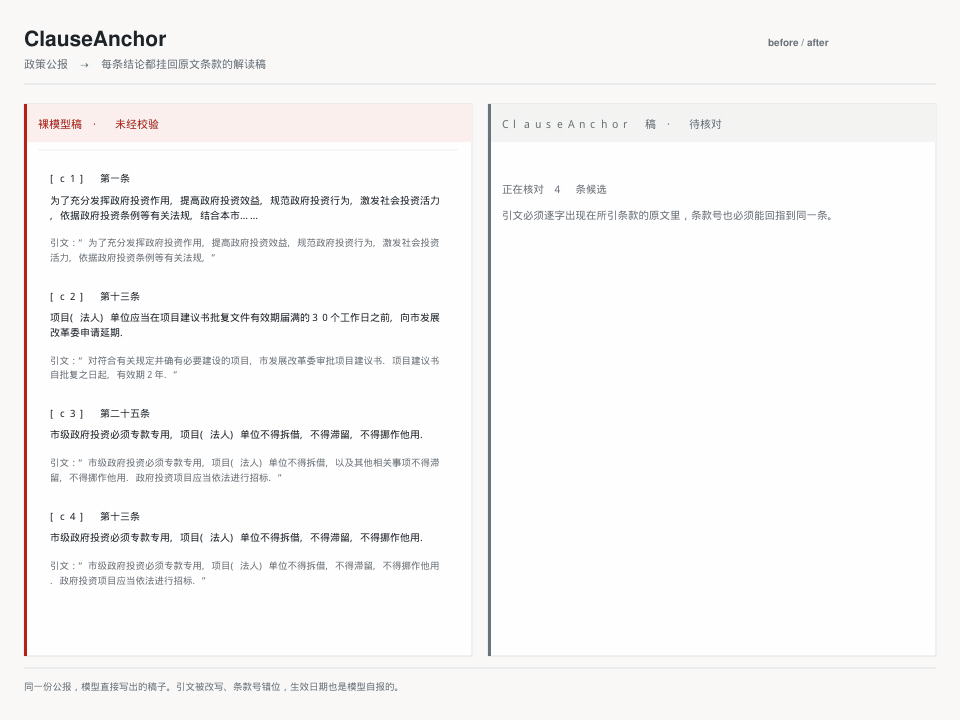
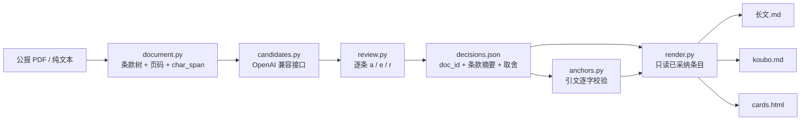

[English](./README.en.md) | **简体中文**

<p align="center">
  
</p>

<h1 align="center">ClauseAnchor</h1>

<p align="center">
  <b>把政策公报拆成第 X 条，让每条结论都挂回原文引文与生效日期。</b><br>
  模型只出候选，你逐条 <code>a</code> / <code>e</code> / <code>r</code> 取舍，最后导出公众号长文、视频号口播稿与可直接截图的图卡。
</p>

<p align="center">
  <a href="./VERSION"></a>
  <a href="https://github.com/SuperMarioYL/clauseanchor/actions/workflows/ci.yml"></a>
  
  
  
  <a href="./LICENSE"></a>
</p>

> **一句话**：它不负责写得更好，它负责让每条结论的**引文**都能在所属条款里逐字找到，并让结论里点名的每个**条款号**都是该条已校验过的条款。

---

## 为什么需要它

通用模型写政策解读已经够顺了，问题出在几个低熵标识上：条款号、生效日期、适用范围。模型会把 `第X条` 当成普通数字去顺句子，会"顺手"补一个看起来合理的日期，也会把别处的原文混进来。文风越好，错误越难发现。

而"请给出处"通常只回到文档级——作者拿到的是一条《XX 通知》的链接，还得自己翻到第几条。于是真正的时间不花在写，花在核对：把每条结论抄回原文，逐字确认。这是采用模型之后新增的成本，不是提示词能解决的。

ClauseAnchor 把这一层单独做出来：

- 解析时保留 `第X条` / `第X款`、页码和字符位置，而不是切 chunk；
- 每条结论必须带一段原文引文，引文归一化后必须是所属条款的**精确子串**；
- 结论正文里点名的每个 `第X条` / `第X条Y款` 也必须是该条已校验、且在文档中存在的条款路径之一；
- 引文只和这条结论声称的条款比对，不允许"反正原文里有，就自动改挂到别的条"；
- `decisions.json` 记下源文件 `doc_id` 和每条条款的正文摘要，导出前重新解析源文件核对。

任何一项对不上，导出直接失败，并指出是哪一条。

## 十分钟上手

需要 Python 3.11+ 与 [uv](https://docs.astral.sh/uv/)。首次 `git clone` 与 `uv sync` 需要联网；安装完成后，`demo`、`parse`、`render` 全程离线运行（不需要 API key，也不访问网络），只有对真实模型运行 `draft` 时才会调用接口：

```bash
git clone https://github.com/SuperMarioYL/clauseanchor.git
cd clauseanchor
uv sync
uv run clauseanchor demo
```

`demo` 用内置样例走完"解析 → 候选 → 取舍 → 出稿"，并在 `out/` 写出：

```text
out/decisions.json
out/长文.md
out/koubo.md
out/cards.html
out/demo-raw-model-draft.md
```

其中 `demo-raw-model-draft.md` 是未经校验的模型原稿，故意包含一条被改写的引文和一条挂错条款号的引文；它们不会进入另外三个成品文件。

## 对照：裸模型稿与锚点稿

<p align="center">
  
</p>

这张 GIF 的左右两栏不是手绘示意图，而是同一次 `clauseanchor demo` 的两份实际产物：

- 左边取自 `demo-raw-model-draft.md`：4 条候选里，`c3` 的引文被插入"以及其他相关事项"，`c4` 把第二十五条的原文挂到第十三条。GIF 左侧面板按原稿画出条款号、模型结论和引文；模型自报的生效日期 `2027-01-01` 也出现在 `demo` 的终端输出和 `docs/demo-results.json` 里，只是成品不会采用它。
- 右边取自 `长文.md`：只留下 2 条通过校验的结论，每条带 `第X条`、页码、生效日期与原文引文；日期来自解析结果 `2026-08-01`，不是模型自报的那个。
- 中间的核对页取自 `decisions.json`：`c3`、`c4` 被标为"拦下"，并指出各自的条款号。

对照图使用仓库里的真实政策 PDF：[上海市市级政府投资管理办法](https://www.shanghai.gov.cn/nw12344/20260731/a637d94307e44a6789df18fa31f34c4b.html)（沪府规〔2026〕5 号，2026-08-01 施行，8 页 37 条）。重新生成（需要 `ffmpeg` 在 `PATH` 上）：

```bash
uv run python assets/demo/make_clause_diff.py
```

演示里的候选来自一个固定的离线"示例模型"，取舍规则也是固定的：引文通过就采纳，否则剔除。`demo` 不调用任何模型接口，所以这两个数字可以重复。真实使用时，候选来自 DeepSeek / Qwen 的 OpenAI 兼容接口，取舍由你逐条决定。每次运行的命令与输出记录在 [docs/demo-results.json](./docs/demo-results.json)。

## 真实用法

```bash
# 1. 解析：看条款树、页码与生效日期
uv run clauseanchor parse examples/real/sh_gov_investment_management.pdf

# 2. 起草候选并逐条取舍（需要 OpenAI 兼容接口）
export DEEPSEEK_API_KEY=sk-...
uv run clauseanchor draft examples/real/sh_gov_investment_management.pdf --model deepseek

# 3. 出稿：引文校验不过则整包拒绝导出
uv run clauseanchor render decisions.json -o out
```

第 2 步会逐条显示 `第X条`、原文、结论与锚点状态，然后等待输入：

| 按键 | 作用 |
| --- | --- |
| `a` | 采纳这条结论 |
| `e` | 改写结论，并粘贴原文中的真实片段修复引文 |
| `r` | 剔除，不会出现在任何导出文件里 |

`--model` 接受短别名 `deepseek`、`deepseek-r`、`qwen`，也可以直接给真实的模型 id；`--base-url` 可以指向任意 OpenAI 兼容端点：

```bash
uv run clauseanchor draft 公报.pdf \
  --base-url https://dashscope.aliyuncs.com/compatible-mode/v1 \
  --model qwen-plus
```

已经有一份 `decisions.json` 时，可以非交互重放。重放会重新解析源文件、核对每条快照摘要并重跑引文校验，不调用模型：

```bash
uv run clauseanchor draft --decisions decisions.json -o decisions.replayed.json
```

## 工作原理



单进程 CLI，六个职责清楚的模块，没有常驻服务、账号体系或云端存储：

| 模块 | 职责 |
| --- | --- |
| `document.py` | PDF / 文本 → 条款树；页码、`char_span`、发文字号、生效日期；源文件身份与快照核对 |
| `candidates.py` | 调 OpenAI 兼容接口，解析模型返回的 `conclusion` / `clause_ids` / `quote` |
| `anchors.py` | 归一化、引文闸门与结论条款号闸门：NFKC、去空白、最短长度、纯标点/虚词拒绝 |
| `review.py` | 终端逐条取舍、`decisions.json` 读写、非交互重放 |
| `render.py` | 只用已采纳条目渲染长文、口播稿、图卡 |
| `demo.py` | 离线跑完整流程的内置演示 |

导出的五道闸门：

1. **逐字子串**：引文去掉空白、统一全角半角后，必须是所属条款原文的精确子串。
2. **结论条款号**：结论正文里点名的每个 `第X条` / `第X条Y款` 都必须是该条已校验、且在文档中存在的条款路径之一；写出 `第九十九条` 这类没校验过的条款号会被拦下。
3. **不跨条重指**：只和结论声称的条款比对；断言了不存在的条款会直接报错。
4. **源文件回指**：`decisions.json` 里的条款快照带正文摘要，导出与重放都会重新解析源文件；改快照或改源文件都会失败。
5. **只渲染命中条款**：一条结论即使声称了多个条款，成品里的 `第X条`、页码和生效日期也只取锚点真正命中的那一条。

## 能力与边界

| 能力 | v0.1 现状 |
| --- | --- |
|  第X条 / 第X款切分 | 已实现，保留页码与字符位置 |
|  发文字号 / 生效日期 | 已实现；识别不出会标注"未识别"，不猜 |
|  引文 / 条款号校验 | 已实现；引文必须逐字命中，结论点名的条款号必须已校验 |
|  三种成品 | 公众号长文、口播稿、图卡 HTML |
|  决定重放 | 已实现，需源文件在位 |
|  扫描件 OCR | 未实现，v0.1 只接有文字层的 PDF |
|  法律意见 / 效力判断 | 不做；只保证引文与条款号可回指 |

已经实测的范围是 3 份上海市政府公开 PDF：2 份市属部门联合发文、1 份市级人民政府发文，共 16 / 41 / 37 条，页码与原文逐条对应。来源、发文字号与解析结果记录在 [examples/real/SOURCES.md](./examples/real/SOURCES.md)。这**不是**对所有机关版式的承诺：附件、修订版/试行版、跨页表格仍可能切错，先用 `parse` 看一遍，再开始起草。

产品的边界写在第一屏：不做条款效力判断，不输出法律意见，不自动发布到公众号或视频号后台。图卡只输出 HTML，由你截图或排版。

## 配置

| 位置 | 作用 |
| --- | --- |
| `CLAUSEANCHOR_API_KEY` | 首选的接口密钥 |
| `DEEPSEEK_API_KEY` | 备用密钥 |
| `OPENAI_API_KEY` | 备用密钥 |
| `--base-url` | OpenAI 兼容端点，默认 `https://api.deepseek.com/v1` |
| `--model` | 模型 id 或短别名，默认 `deepseek-chat` |
| `--max-claims` | 一次请求的候选条数，默认 6 |
| `--templates DIR` | 替换三个 Jinja2 / HTML 模板 |

`decisions.json` 记录源文件路径、`doc_id`、每条条款的正文摘要与取舍结果。它不含 API key，不含整份原文；离开源文件无法独立渲染，这是有意的设计。

## 付费方式

本地 CLI 与 Skill 以 MIT 开源，在自己的机器上运行不收费，也不按 token 计费。付费的是本地跑不动的那部分——托管解析额度，面向园区招商、券商研究所和 3–8 人内容工作室这类把"条款可回指"当合规要求的团队。

| 方案 | 内容 | 首版价格 |
| --- | --- | --- |
| 个人 | 托管解析额度：长 PDF、批量公报 | 19 元/月，含 60 次解析 |
| 工作室 / 机构 | 团队席位 + `decisions.json` 归档留痕 + 固定版式成品模板 | 99 元/席位/月，5 席起（整组常见成交 399 元/月） |
| 扫描件加急 | 图片型红头文件 OCR | 5 元/份 |

为什么按席位与额度收费：锚点需求在这些团队里是合规要求而不是效率偏好，能开票、能走部门预算；按 token 计价既对不上他们的预算口径，也不反映真正的成本（解析与人工兜底）。

**托管解析服务尚未在 v0.1 上线**，上表是首版方案，不是已开通的购买入口。正式计费前会在这里更新开通方式、额度规则与条款。v0.1 没有账号、云端存储与遥测，本地功能不依赖任何服务。

## 路线图

**v0.1.0 已完成**

- 有文字层 PDF 与纯文本的条款树解析，保留页码与字符位置
- 候选起草、逐条 `a` / `e` / `r` 取舍、`decisions.json` 重放
- 引文校验、源文件回指、只渲染命中条款
- 公众号长文、口播稿、图卡 HTML 三种成品
- 离线 `clauseanchor demo`、`SKILL.md`、双语 README 与真实对照图

**计划中（不在 v0.1 中）**

- 托管解析端的扫描件 OCR 与批量公报队列
- 附件表格的结构化抽取
- 条款修订对照与政策时间线
- 团队归档：谁采纳了哪条、引文是什么，可回查
- PyPI 一键安装与更多已实测机关版式

## License

<p align="center"><sub><a href="./LICENSE">MIT</a> © 2026 SuperMarioYL</sub></p>
